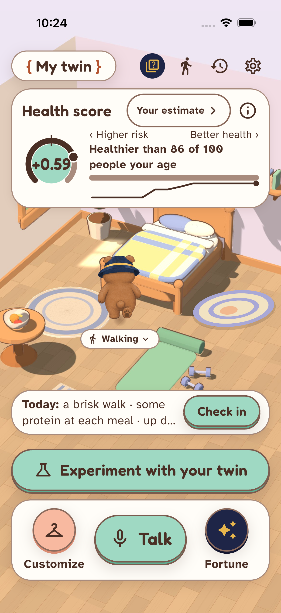

# Model acceptance #107 — October 24, 2026

**Verification completed with findings.** The actual iOS 26.4 repository/model run and both independent numerical
oracles pass. The separate endpoint supplement still reproduces the known recommendation-wording defect
[#124](https://github.com/ViktorOsadsky/lifetwin/issues/124); this is not an overall product-safety pass.
No app, engine, UI or contract code changed in this acceptance branch.

## Exact release and scope

Tested source is merged main **`9ace866404bb8df89de673dd299041e25791ccad`**, including the owner-approved
projection merge [#126](https://github.com/ViktorOsadsky/lifetwin/pull/126) at
`41dce102e00c6a1e8baccb83f53a4d5b313f771f` and subsequent centered-score merge
[#138](https://github.com/ViktorOsadsky/lifetwin/pull/138). The former release hold was resolved by the actual
merge before execution. PR126's final head was `614e37dfb1cdb390010f9f6f6b0edd35a5b5baf8`.

The original #107 ratio/reference 1.0 premise was superseded by the owner's centered-score change:
`healthScore = median(s in the same-sex/age group) − s(profile)`, with Cox age/sex terms excluded from s.
The midpoint is now **0**, positive is healthier, and negative is lower relative standing. No separate hazard
ratio getter was invented. Current compare keys are `health_score_current/alternative/delta`; history scale is
`cox_centered_v1` with `centered_score`. [Pinned adapter](https://github.com/ViktorOsadsky/lifetwin/blob/9ace866404bb8df89de673dd299041e25791ccad/app/lib/twin/twin_model.dart).

The run used the actual isolated app `com.danielqi.lifesim.modelqa107`, iPhone 17 Pro simulator
`7F21AE4A-232B-458E-A5B7-F7EA7952BD01`, **iOS 26.4**. The harness loaded production assets and production
`openTwin`/`TwinRepository`/`TwinModelService`/projection code, with fresh synthetic `MemoryBackend` stores.
It does not claim that its static test scaffold is the finished product UI. No physical phone, HealthKit writes,
real health profile, live provider or live backend was used by this simulator target.

## Actual four-profile results

Values below are unrounded in the [capture](../qa/model-acceptance-2026-10-24/capture.json). S5 is the current Cox
five-year survival percentage; the lifespan summary is a projection median or mean/median blend, not S5 converted
into a death age. The range is the implemented 25th–75th bound summary, not a confidence interval. `110+` means a
threshold was not reached by the simulation endpoint. [Summary method](https://github.com/ViktorOsadsky/lifetwin/blob/9ace866404bb8df89de673dd299041e25791ccad/app/lib/twin/lifespan.dart).

| Synthetic record | Centered score | Percentile | Raw Cox log hazard | S5,% | Lifespan summary(range) | Year | Projection weight/status |
| --- | ---: | ---: | ---: | ---: | --- | ---: | --- |
| Rosa, effective seed after history |+0.5932693521|85.71428571|−0.1283793640|97.18394161|100.2050(88.5059–110+)|2062|1,available|
|45male|+1.0556105278|97.29729730|−1.5341187125|99.30208126|101.9307(88.7726–110+)|2083|1,available|
|58female|−0.0230361698|48.20143885|+0.1473584371|96.30653032|90.3825(79.2033–100.1878)|2058|1,available|
|76male|+0.0505075823|51.67785235|+1.5767644214|85.45604663|89.7728(84.0080–95.5400)|2040|1/3,extrapolated|

Rosa's **effective** model profile was age 64, sex 2, BMI 25.148683221149557, sleep 6.9 h, sitting 420 min/day,
moderate 120 min/week, vigorous 0, smoking 0, diabetes 0, hypertension 0, general-health 3. Provenance is
`weekly_summaries`, October 12–18, 2026, one complete week. The exact other three supplied/effective profiles and all
group labels, component curves, flags, years and null masks are recorded; no manual profile reconstruction or
hardcoded result was used. The four group labels are women 59–69, men 40–50, women 53–63, men 71–79, with spaces in the
actual display labels.

The independently reconstructed same-group median reference produced **2.498001805406602e−16**, within
the 1e−9 tolerance of 0.0. Four BMI-only+1 comparisons each returned `weight_guard:true`, zero survival difference
at every horizon, zero centered-score delta, identical guarded current/alternative curves and no confirmed-profile
mutation. Legitimate reference zero is distinguished from missing numeric values, which remain null.

## Independent comparisons and boundary checks

- **Canonical Dart oracle: PASS, exit 0.** Imports `model_handoff` directly, independently loads its artifacts, and
  compares raw hazard, current S5, centered score, percentile/group, every projection-component point/median/tail flag,
  selected projection curves where used, reference 0 and masks. Absolute tolerance 1e−9. The compressed app support
  reference decompresses byte-for-byte to the canonical reference; vendored projection/neural source and neural
  asset equal canonical bytes. [Canonical results](../qa/model-acceptance-2026-10-24/canonical-results.json).
- **Independent Python CDC/blend oracle: PASS, exit 0.** Uses the existing Python life-table reference, not the
  app wrapper, for every CDC point/mean/percentile and all weighted summaries, bounds, year, open flags, status, headline
  and selected curves. Its projection component is independently checked by canonical Dart. Four primary,
  fourteen integer boundary and five direct fractional-wrapper cases are covered.
  [Blend results](../qa/model-acceptance-2026-10-24/blend-results.json).
- Integer edges 18/34/35/39/40/44/45/70/74/75/78/79/80/85 exercise table/projection/blend boundaries and rough-guide
  selection. Ages 17/86 and missing sleep retain null unsupported/missing outputs. Adjacent differences are
  recorded as observations, not proof of continuous aging or calibration.
- Three negative controls reject a stale 1.0 reference, a corrupted blended summary, and a host fixture masquerading
  as device acceptance. [Control results](../qa/model-acceptance-2026-10-24/oracle-negative-controls.json).

### Fractional ages: two different boundaries

An initial simulator test failed because its fixture incorrectly expected fractional **confirmed intake** to
produce a repository estimate. Only the fixture/acceptance harness was corrected. The failed artifact/log remain
under `/private/tmp/lifetwin-qa107-first-failed-{capture.json,model.log}`; no product code changed to get a pass.

Actual source path: `saveOnboarding()` passes `confirmed_profile` to `saveConversationProfile()`, which calls
`mergeConfirmed()`. The profile schema requires age `_whole(v,0,120)`; fractional age is refused. In a **fresh empty
store**, age is absent afterwards, so the assessment is `missing_inputs` with `['age']`, and score, S5, lifespan
are null. If a known age already exists, the merge rule retains it. The model-field mapper itself accepts finite
numbers; it is not the rejecting layer. [Write path](https://github.com/ViktorOsadsky/lifetwin/blob/9ace866404bb8df89de673dd299041e25791ccad/app/lib/twin/twin_repository.dart#L255),
[age validator and merge](https://github.com/ViktorOsadsky/lifetwin/blob/9ace866404bb8df89de673dd299041e25791ccad/app/lib/twin/checkin_applier.dart#L18).

The **direct `LifespanEstimate.forProfile` helper** separately accepts a supplied fractional model age: CDC and
blend weight use that actual age; the projection uses its floor. It does not grant fractional confirmed-profile
eligibility or replace the caller's model-support checks. Direct 34.5/35.5/40.5/74.5/79.5 estimates and their separate
repository masks were exercised on the simulator; both independent oracles pass. This reconciles the final
fractional-age fix without falsifying the confirmed-data contract.
[Direct helper](https://github.com/ViktorOsadsky/lifetwin/blob/9ace866404bb8df89de673dd299041e25791ccad/app/lib/twin/lifespan.dart#L214).

## Product routes, server findings and real/fixture distinctions

**Host UI supplement:** all 49 existing tests in `experiment_screen_test.dart`, `ideas_test.dart` and
`wellness/coach_test.dart` pass against the frozen merged copy. These cover Experiment's lack of any weight/BMI
lever, the information-only weight card, Ideas→Experiment presets/null targets, adult gates/entry points, and plan
parsing/error recovery. They use deterministic clients and are **host tests**, not actual provider or simulator
product-route acceptance. The simulator's four BMI comparisons prove the model/service guard; they do not prove
arbitrary server wording is safe.

**Actual endpoint supplement supplied by root:** real FastAPI endpoints through in-process TestClient, synthetic
profiles, no external provider keys/calls. Baseline and BMI+1 produce identical nonempty recommendation 3 / plan 4
items and coach spoken lines. A fake consented provider is called once per case: recommendations still publish
“Getting heavier helps your health.” and “Putting on mass improves your outlook.”, while rejecting the literal
“Gaining weight improves survival.”. Coach rejects all three. **Known #124 remains FAIL/open; no duplicate bug filed.**
[Full synthetic endpoint evidence](../qa/model-acceptance-2026-10-24/server-checks.json),
[reproduction](../qa/model-acceptance-2026-10-24/server_check.py).

After QA107 released the simulator, #133 captured the **actual normal-main Home** via native XCUITest at the same
source pin. Root supplied this separate screenshot and it was independently viewed: it shows **+0.59** and
**“Healthier than 86 of 100 people your age”**, matching rounded simulator model values. This is
separate product-Home evidence, not a screenshot of QA107's custom model scaffold. It does not establish the rest
of the final intake/Experiment/plan/Ideas/voice flow.



## Reproduction, environment and handoff

All copied production Dart/assets (520 files) matched the frozen acceptance worktree. Selected production/canonical
SHA256s, original/compact capture hashes, harness hashes, source pins, test exits and simulator cleanup are in the
[manifest](../qa/model-acceptance-2026-10-24/manifest.json). The compact JSON preserves the actual captured values;
it is not a reconstructed result. [Simulator log excerpt](../qa/model-acceptance-2026-10-24/simulator-log-excerpt.txt).

Installed tools were Flutter 3.47.0 / Dart 3.13.0. Only the temporary app lowered `^3.13.7` to `^3.13.0`; repository
SDK/lockfiles and production sources stayed unchanged. No newer installed SDK was available. Static analysis of
the original two harness files and canonical oracle passed before execution; final source also compiled and ran
on the simulator. The final target exited 0; original failed attempt exited 1 as documented above.

For a fresh approved simulator run, synchronize a new isolated app from the exact pin, preserve its isolated bundle,
copy [integration_test.dart](../qa/model-acceptance-2026-10-24/integration_test.dart) to
`integration_test/qa107_engine_integration_test.dart` and [driver.dart](../qa/model-acceptance-2026-10-24/driver.dart)
to `test_driver/qa107_engine_driver.dart`. Use `flutter drive` with the assigned simulator UDID,
`--dart-define=QA107_ENGINE_APPROVED=true`, `--dart-define=QA107_MERGED_SHA=9ace866404bb8df89de673dd299041e25791ccad`
and `QA107_CAPTURE_PATH=/private/tmp/qa107.json`. These defines record a previously verified approval; they do not
grant one. The driver writes failures too, so require successful terminal exit and `device_assertions_passed:true`.
Both oracles reject unapproved/host-as-device captures.

From repository root, independently verify the committed capture without a device:

```sh
dart docs/qa/model-acceptance-2026-10-24/canonical_oracle.dart \
  docs/qa/model-acceptance-2026-10-24/capture.json /private/tmp/qa107-canonical.json
python docs/qa/model-acceptance-2026-10-24/blend_oracle.py \
  docs/qa/model-acceptance-2026-10-24/capture.json /private/tmp/qa107-blend.json
PYTHONPATH=server python docs/qa/model-acceptance-2026-10-24/server_check.py
```

The simulator started Shutdown. After the final driver exited, app termination found nothing running (exit 3),
isolated-app uninstall succeeded (exit 0), and Shutdown restoration succeeded (exit 0). Access was immediately handed
to #133; no subsequent QA107 simulator use occurred. A post-shutdown container lookup cannot verify installation
state in that state, so removal evidence is the successful uninstall command, not a false claimed lookup pass.

Track/task: C acceptance #107. Branch `codex/c-model-acceptance`, separate worktree based on 9ace866. Changes are only
this handoff and synthetic QA evidence/reproduction scripts; local commit at author handoff, no push/PR/merge.
Next dependencies: root opens the acceptance-record PR after review; #124 needs its owner’s wording-filter fix;
Daniel/#133 retain final product/demo and physical-device acceptance. The long-range summaries remain an
unvalidated proof of concept; numerical parity is not clinical validation.
