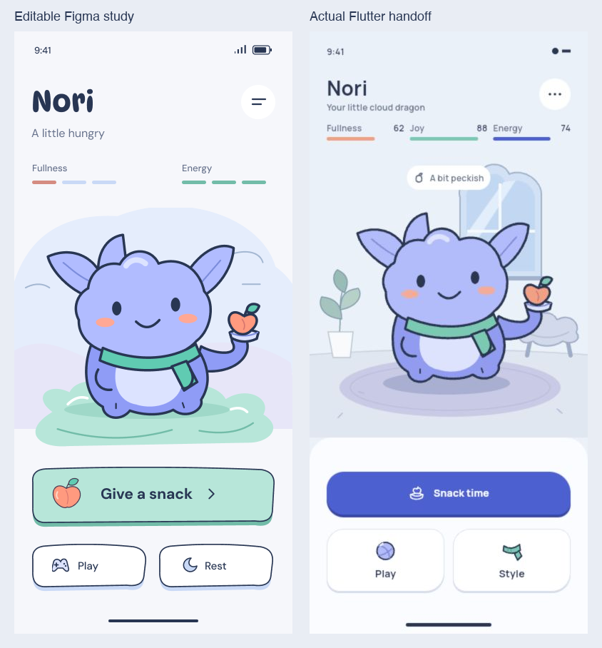

# LifeTwin UI redesign handoff

Prepared 24 October 2026 for the agent taking full ownership of the LifeTwin UI.

**Rebuild the UI from scratch.** The user has stopped this design session and its subagents. Existing layouts, characters, screenshots, quality scores and partially completed Figma screens are experiments, not an approved design to finish. Carry forward the product behavior, implementation constraints and user preferences below; take independent responsibility for the new visual solution.

## Start here

LifeTwin should feel like a charming illustrated mobile game that happens to help people explore health habits. It needs an original, very simple human twin, a small friendly guide called Pip, tactile controls, spacious composition and unusually good visual craft. Older adults are an important audience. The experience should be welcoming and immediately understandable, without turning into a clinical dashboard or a children's reward shop.

The strongest visual instruction is the **LEFT side** of the user's Nori comparison. The right side is the implementation they disliked. Match the left's relationships: a large simple character, confident navy contours, pale lavender scenery, mint ground and button, white outlined secondary controls, sparse text and generous space. Nori is a style reference; it is not a request to replace LifeTwin's human twin with a dragon.

Do not inherit the last agents' interpretation merely because it is newer. The user most recently said the characters were too complex, then asked for a complete handoff so another agent could completely remake the UI. That is the current decision.

## Direct user instructions and their precedence

These are the user's preferences from this conversation, summarized rather than inferred from repository documents:

- Make it creative, stylized, game-like, cute and visibly authored. It should feel hand designed or drawn, with a clean contemporary finish rather than a rustic treatment.
- Scrap the old designs and create new ones from scratch. Repeatedly polishing the rejected work is not the task.
- Use the left Nori study as a visual reference and study excellent contemporary cute interfaces.
- **Simplify the characters.** Use fewer shapes, fewer details and flatter colors. Complexity is a failure even when the illustration is technically modular.
- Keep screens clear, enjoyable and useful. Remove extraneous captions and explanatory filler.
- Design for mobile and Flutter, including game-like interaction and motion. Earlier requests for web scroll animation do not require scroll storytelling on a native pet home screen.
- Use the curated design skills and a fresh-context critic. Judge rendered outputs against actual references, iterate and move quickly.
- Preserve the intended design when implementing it. The user specifically challenged why the left Figma study became the different-looking right implementation.
- Visual prototyping does not require building actual audio generation or unrelated backend systems.
- The current agent and all its subagents must stop UI production. The receiving agent owns the remake.

Repository documents supply product constraints and implementation facts. They do not silently override these later explicit visual instructions. In particular, older prescriptions for a blue filled primary, a detailed sunroom or an inherited character rig are not reasons to reproduce them.

## Product and information architecture

LifeTwin is the working product name; existing code may still use LifeSim or package `lifesim`. It is a Flutter mobile app with SVG illustration and Lottie motion. The core journey is:

1. Meet the twin and Pip in a welcoming room or character scene.
2. Talk or type with Pip, answering one health question at a time.
3. Check the extracted answers and explicitly record confirmed measurements.
4. Visit a magic-ball outlook scene, with an honest unavailable state while prediction is deferred.
5. Explore cited educational suggestions and hypothetical changes.
6. Play a food or everyday-decision quiz with immediate, gentle game feedback and a recovery path.
7. Return to the room, customize appearance, and review activity or new measurements.

This is one connected world with useful modes and panels. A dashboard of cards and a traditional multi-page health form miss the intended experience. The existing Room / Plan / Activity organization is a useful starting point, not a requirement to preserve old tab geometry. Every full-screen activity needs a clear way back that preserves its invoking context.

The real person, their draft answers, recorded measurements, hypothetical experiment, cosmetic settings and quiz score are different kinds of state. The interface must make their consequences understandable without showing internal variable names.

## Visual direction

### Character design

Aim for a recognizable silhouette at phone size before adding anything inside it. Use broad rounded shapes, dot or small oval eyes, one simple mouth, a restrained expression and little interior detail. Emotion should come mainly from posture, eye placement and timing. Flat fills with one limited highlight or shadow are sufficient.

For the human twin, the last simplification direction was a round face, a smooth hair cap, a plain mint shirt and short lavender trousers. For Pip, it was a mint bean or sprout with two leaves and a simple face. These are useful limits, not approved final character designs. The receiving agent can redraw them completely within the brief.

Avoid detailed overalls, pockets, straps, layered shoes, satchels, tiny seams, shiny skin, elaborate hair or many accessories on the default character. Small decorative marks accumulate quickly. Test the silhouette and face at their smallest actual use, not only in a large component preview.

Keep the twin and Pip distinct in silhouette, scale and role. A human twin should remain understandable as the user's avatar; Pip is the guide. Inclusive skin tones, age cues, hair and access aids should fit the same simple illustration grammar. A wheelchair needs an intentionally seated pose, not a chair drawn over a standing body. Aids should be properly drawn and fitted rather than represented only by labels or metadata.

### Color, line and space

The latest reference direction used these approximate colors. They are starting points to refine after rendering, not a mandatory untested token system:

| Role | Starting color | Use |
| --- | --- | --- |
| Cool paper | `#F6F6FC` | Main ground and breathing room |
| Navy ink | `#313C61` | Text and confident outlines |
| Lavender | `#A8A9F0` | Character or major playful accents |
| Mint | `#B3E4D7` | Ground, selected moments, primary action |
| Coral | `#FF9F8B` | Small warm accents |

Use a consistent contour family, purposeful curves and controlled asymmetry. Hand designed does not require wobbly text, noisy paper, distressed edges or inconsistent stroke widths. Pastel surfaces still need readable text and visible boundaries.

Make the character the focal point. The left reference gives it substantially more importance than its surrounding labels. A few organic lavender waves and a mint puddle can establish place. Avoid adding windows, furniture, plants, storage, mirrors or architectural decoration until the scene demonstrably benefits from them. The latest direction rejected architecture-heavy scenery.

Let the scene flow into the page ground. No visible rectangular canvas behind imported SVGs, abrupt horizon seam or rounded card enclosing the habitat. Any deliberate background bleed must be intentional; focal characters, eyes, controls and badges must remain intact.

### Controls and type

The preferred primary is mint with navy text and outline, a generous rounded or subtly organic shape and a small offset lower lip. Its pressed state compresses locally. White outlined secondary controls belong to the same family. Start with one clear primary and a small number of understandable alternatives.

Draw simple purpose-specific icons that match the illustration. Generic emoji and a mixture of unrelated outline icon families dilute the design. The icon should explain the action; it should not need a caption explaining the decoration.

Headings may use an expressive rounded face; longer UI text needs a highly readable face. Bricolage Grotesque and DM Sans were available and used in the experiments, but the user has not approved a final font pair. Verify actual font availability, metrics, wrapping and enlarged text. Do not shrink body copy to make a composition fit.

For list-oriented screens, use open spacing and warm illustrated category icons or tinted icon tiles. Earlier heavy stacked cards were rejected; a subsequent plain hairline-only replacement was also considered bland. Give lists character through their useful objects and typography, not a new container around every row. Selection chips are appropriate when they select something; decorative chips around values are not.

## Copy and accessibility

The working content budget is one idea per screen, titles around four words or fewer, and at most one short supporting line around eight words. Row labels should be brief. Pip's ordinary speech should fit in a short bubble. These are editing targets, not permission to omit a material consent disclosure or a needed explanation.

Prefer everyday words such as “Your measurements,” “Try a change,” “Check your answers” and “Not now.” Avoid casual interface jargon such as cohort, baseline, sensitivity scan or modeled gain. Put supplementary explanation behind a clearly named detail action. Keep the essential meaning, processor and data scope visible before consent.

Be kind and factual around health. Avoid threatening red numbers, death countdowns, guilt, diagnoses and wording that equates body size with virtue. A wrong quiz answer should teach and offer recovery. Do not make illness frightening or suggest a game score describes the user's health. Honest unavailable states should still offer a useful next step.

Design first at 390 × 844 logical pixels, with representative top and bottom safe areas of 47 and 34. Use the actual device insets in Flutter. Check short/narrow 320 × 693 and larger 430 × 932 layouts. Include enlarged text; the recorded handoff targets include 320 × 693 at 1.6 text scale and 430 × 932 at 1.0. These sizes were targets, not completed runtime tests.

Use approximately 48 or larger touch targets and 56 or larger primary actions. Important secondary text should generally remain at least 15 logical pixels. Check contrast rather than assuming a pastel palette is accessible. Grow, reflow or scroll when text needs space. Keep the current question, answer field and send action usable above the keyboard. Labels and selected states must work without color alone. Draw focus, pressed, selected, locked, loading, disabled and error states where the interaction needs them.

If using a floating tab bar, measure the icon-and-label group inside the actual bar. Do not count the home-indicator safe area as extra padding on one side and call the contents centered. Pad scrolling content so its last action clears the bar and gesture area.

## Motion and interaction

Motion should connect an action to its nearby result: a button depresses, Pip acknowledges an answer, a selected accessory appears immediately, a quiz answer locks and the twin reacts. Do not add floating motion everywhere to compensate for weak static composition.

Author a small coherent family: idle, listening, thinking, speaking, acknowledging, gentle tired response, recovery and magic-ball interaction. Use short, interruptible transitions and preserve the committed state when an animation is canceled. A reduced-motion alternative should communicate the same result with a static pose or brief nonspatial change. Tap controls must provide alternatives to hold, drag or shake gestures.

Lottie is the confirmed motion authoring direction. A continuous game engine is unnecessary unless actual gameplay requires it. SVG is appropriate for modular static art. A Figma prototype can specify motion intent; it does not establish Flutter timing, performance, persistence, audio behavior or screen-reader support.

## Screen coverage and behavior

These identifiers describe the existing product map, not a demand to reuse its screen layouts or names.

| Screen | Purpose and essential behavior |
| --- | --- |
| F1 Room | Character-first home, immediate way to talk with Pip, useful access to outlook, quiz, customization and experiments. Scenery is not a clinical assessment. |
| F2 Conversation | Same question and draft in talk and type modes. Separate voice and optional AI-helper choices. Captions, clear listening/stop state, corrections, unit clarification, skip or unknown, keyboard and unavailable paths. |
| F3 Review | Human-readable answers with values, units and provenance; change, yes/no and back paths. No silent health-data commit. |
| F4 Fortune | Charming magic-ball activity with an honest current unavailable state. Future results must use actual supported model output. |
| F5 Explore changes | Educational directions while sensitivity is unavailable; no invented personalized ranking or numerical gains. |
| F6 Plan | Short practical suggestions with cited sources and details. Select or dismiss a next step. Distinguish educational guidance from a measured personal effect. |
| F7 Try a plan | Show the actual assumptions a plan would apply to a hypothetical scenario. Unsupported actions stay unmodeled. |
| F8 Experiment | Clearly separate hypothetical input changes from recorded measurements. Edit/reset scenario only; no fake comparison curves while the service is deferred. |
| F9 Quiz | A complete reviewed question with understandable choices; selection differs from submitted/locked state. Prevent duplicate scoring. |
| F10 Recovery | Gentle explanation and a one-time recovery path; practice remains unscored. Wrong answers affect game state only. |
| F11 Studio | Large live preview, understandable category/result relationship, drawn options and visible selection. Useful default; customization never blocks the main journey. Body policy conflict below must be resolved. |
| F12 Activity | Honest empty state, source-labeled Health or manual activity, meaningful detail. No fabricated real chart. |
| F13 Log activity | Minimal manual entry, units and clear save/cancel; return to the originating activity context. Logging is not a measured physiological improvement. |
| F14 Apple Health | Explanation, permissions, readback with source/date/units, checked values, partial data, nothing found and denial. Preserve a conversation fallback. |
| F15 Record measurements | Explicit confirmation before a new real baseline. Show any relevant consequence for an existing experiment and provide a safe back/cancel path. |

Cover the critical variants rather than generating a new phone for every minor criterion: first visit/returning; consent accepted/declined; mic denied; helper unavailable/off/on; typing with keyboard; checking/cancel/error; correction; unknown units; Health partial/empty; record confirmation; quiz selected/locked/wrong/recovery; plan source unavailable; experiment reset; Studio selected/default/access-aid fit; empty and populated Activity.

Representative complete paths:

- Room → talk/type → candidate answer → review → record → outlook → plan → hypothetical change → experiment/reset → quiz/recovery → Room.
- Conversation → Health permission/readback → remaining conversation question → review.
- Activity → manual log → Activity; separately, record new real measurements → confirm.
- Room → Studio → selection → return, with no health-data changes from cosmetic controls.

## Data and implementation truth

At the checked source snapshot, prediction, comparison and sensitivity services remain deliberately deferred with HTTP 501 and null model fields. Do not make the new UI appear connected to a working longevity model. No fabricated survival probabilities, personal death dates, ranked “best” levers, numerical scenario gains, physiological changes or decorative curves presented as real. Educational plan sources do not establish a personal prediction. An unavailable prediction does not mean a zero benefit.

The source documents have stale status paragraphs: some still say no Flutter app or voice provider exists, while current main includes Apple Health, Cartesia voice onboarding and helper-consent code. Check current source and configuration before promising a live integration. Do not infer provider readiness from an adapter being present.

Important boundaries from the reviewed code and requirements:

- Current Health import submits checked numeric values through `POST /api/onboarding/turn` with `action=import`; that path returns before the optional AI extractor. Raw Health samples are not automatically sent to an AI model.
- A future raw-sample helper path needs its own implemented route and scoped disclosure. Earlier planning mentioned 30 days with source/device names removed; that is not current behavior or a promise to display as already implemented.
- Voice consent covers Cartesia processing; AI-helper consent is separate. Typing must remain fully usable. Identify the actual configured AI processor; OpenAI-specific copy belongs only to a verified OpenAI configuration.
- A visible helper state must distinguish on, off and unavailable. Revocation stops future processing/capture as applicable without losing checked answers. It cannot retract data already sent.
- Do not assume third-party retention equals LifeTwin retention. Avoid broad claims such as “no one keeps recordings” without verified settings.
- Read back actual values, units, dates and source. Unknown values stay unknown; ambiguous units need a question. Preserve meaningful zeros.
- Session answer confirmation and final baseline recording are separate. A plan, quiz, appearance change or experiment must not silently record new clinical measurements.
- Quiz effects are bounded game state. The reviewed yogurt question uses total sugar 12 g and added sugar 5 g with three answer choices; read the actual question and keyed answer from the reviewed bank rather than inventing one.
- Keep real activity source labels honest. Do not relabel a manual entry as Apple Health or show invented history.

Use current contracts as the implementation boundary. Server credentials stay server-side. No actual health records belong in design exports or demos.

## Unresolved body representation policy

This is a real source conflict, not an artistic choice the next agent should silently settle.

Current main's `MASTER_PLAN.md` separates cosmetics from health inputs. Daniel's newer, unmerged PR23 handover explicitly proposes that body shape and height follow **confirmed** measurements, including confirmed information from Health and conversation. That handover itself says the main team documents conflict and need agreement before shipping. Its final summary also retains older wording about cosmetics, so it is not a clean reconciled contract.

The proposed safeguards are useful if the team accepts that change: never use guessed or unconfirmed data; experiments never reshape the body; use a small set of equally dignified silhouettes without BMI labels; no body size signals better health; skin, hair, age cues and access aids remain user chosen. A “That's not quite me” override was recommended, not decided. No measurement-to-silhouette algorithm or thresholds were agreed.

Keep a simple neutral/default preview while this is reconciled. Do not ship a hidden BMI-to-avatar rule, claim a free body picker is the settled requirement, or let hypothetical improvements make the avatar thinner. This decision does not block rebuilding the rest of the interface.

## References and what to learn

The local curated atlas records prior research as of 23 October 2026. Some entries include visually inspected imagery; others only primary text or research leads. Reopen actual reference frames before asserting a fresh comparison or live behavior. Marketing screenshots do not establish interaction quality. Author original assets; do not copy characters or branding.

| Reference | Specific relationship to study |
| --- | --- |
| User's LEFT Nori study above | Primary art direction: simple subject, contour, mint/lavender balance, spacing and tactile controls. |
| [Duolingo shape language](https://blog.duolingo.com/shape-language-duolingos-art-style/) | Broad flat shapes and purposeful interior marks; simplify character construction without losing expression. |
| [Pok Pok press kit](https://playpokpok.com/press/press-kit/) | Hand-authored toy shapes and direct object/action relationships. Its preschool text model is not appropriate to copy wholesale for older adults. |
| [Toca Boca World](https://www.tocaboca.com/toca-boca-world) | Distinct composition for play, creation and customization; strong silhouettes and visible category/result relationships. |
| [Sago Mini World](https://sagomini.com/world/) | Simple expressive characters and objects that visibly support an activity. |
| [Amaru press kit](https://www.sixwingstudios.com/amaru-press-kit) | Spacious character staging and close relation between the pet and its action tray. Avoid importing environmental detail. |
| [Neko Atsume](https://www.nekoatsume.com/sp/) | Sparse faces and distinctive poses carrying charm without complex shading. |
| [Finch](https://finchcare.com/) | Companion warmth and coherent next actions. Do not turn every game mode into a habit checklist. |
| [Gentler Streak](https://gentlerstories.com/gentlerstreak/) | Encouragement, rest and nonjudgmental self-comparison. |
| [Talking Tom 2](https://talkingtomandfriends.com/apps/my-talking-tom-2) | Care-stage scale, physical props and contextual activity controls. Study interaction architecture, not its character or 3D rendering. |
| [Headspace illustration guidance](https://live.standards.site/headspace/illustration) | Restraint, simple palettes, dynamic scale and emotional expression with few marks. Its no-outline system need not replace the user's preferred contour. |
| [Apple game controls guidance](https://developer.apple.com/design/human-interface-guidelines/game-controls) | Direct manipulation, reachable controls and feedback that remains visible around a finger. |
| [Flutter SafeArea and MediaQuery](https://docs.flutter.dev/ui/adaptive-responsive/safearea-mediaquery) | Edge-to-edge art with protected controls; actual device insets and text-scale behavior. |

Use two or three relevant comparisons per screen, at equivalent phone size. Ask what the reference does better in silhouette, hierarchy, pose, spacing, typography, control feedback or reading density. A large reference collection without a specific observation will not fix the design.

## Skills to use

Read `hackathon-pack/skills/creative-web-worlds/SKILL.md` from the latest repository main. For this task, follow its `flutter-mobile`, `playful-game-ui`, `figma-mobile-workflow` and `mobile-comparison-gates` references. The research index is `mobile-game-source-atlas.md`; the fresh-context evaluation method is `forward-testing.md`.

Local curated copies are under `/Users/flare/.codex/skills/creative-web-worlds/`. `ui-ux-pro-max` and `frontend-design` can supply supplementary layout/UX judgment. Official Figma skills govern the actual API workflow: `figma-use` before programmatic file actions, `figma-generate-design` for composed screens, `figma-generate-library` for component systems, and `figma-design-to-code` before implementation from Figma. Read the applicable installed skill rather than guessing tool behavior.

Daniel's note also mentions Impeccable, HIG and motion skills. Availability was not verified in this session; do not claim those tools are installed. A general-purpose web style recipe should not override native game composition or this user's reference.

## Figma and artifact state at stop

Target file: [LifeTwin Cal Hacks 13](https://www.figma.com/design/HijjDCe1bvFQDlz8upTSWy). File key: `HijjDCe1bvFQDlz8upTSWy`. Editing access was verified by an actual create/remove operation; the earlier seat-permission blocker was resolved. A new agent must establish its own current tool session rather than assume an old session token is portable.

The three active UI workers were interrupted on the user's instruction: art director, intake designer, and play/activity designer. No more UI production is authorized in this session. Interruption happened mid-build, so inspect live structure before touching anything.

| Location | Status at stop |
| --- | --- |
| Flow `6:4`; Room `35:126` | Contains historical work and a recent simplified Room experiment. Not user-approved. |
| Studio `147:1842`; broad example `149:2450` | Recent simplified experiments. Not an approved final Studio or complete customization system. |
| Shared component family `147:*` | Recent native Head/Pip/World/Twin experiments. Simplification/modularity work was interrupted. Verify contents; no obligation to reuse. |
| Shared controls `149:6009`, `149:6013`, `149:6017` | Recent rest/pressed primary and secondary experiments. Not a final adopted system. |
| Fresh Intake and records page `149:5994` | F2 `149:5995` exported; five wrappers `149:5995–5999` were created. Remaining content may be incomplete. |
| Fresh Play and activity page `149:6030` | F4 `149:6031` exported. Other planned cores are incomplete or unverified. |
| Flow handoff v1 `6:5`, States `6:6`, Cover `0:1` | Historical/partial content; do not treat it as the authoritative completed remake. |
| Frozen backups | Components `104:967`, Flow `104:4462`, Cover `104:5879`, States `104:5993`. Preserve history while authoring a clean new direction. |

Before the fresh reset, native backups of the original eight phones, Cover hero and selected twin were checked for exact PNG equality. That establishes preservation of history, not design quality. Old “final-prepared” packages, 64-item checklists and large state counts do not prove the current remake is complete. No final fresh-critic approval or Flutter/device fidelity review was completed for the stopped work.

Local lab root: `/Users/flare/Documents/ChatGPT/Skills/design-lab/lifetwin-figma-refinement/`.

Useful archival evidence, all reference-only:

- `research/ui-requirements.md`, `research/requirements.json`: detailed behavior audit; reconcile with current sources and this handoff.
- `research/design-content.json`: proposed content/state map, not implementation proof; some visual rules and body-policy assumptions are superseded or disputed.
- `live/receipts/`: actual Figma mutation and preservation receipts.
- `experiments/play-studio-v1/room-simple-v2.png`, `studio-simple-v2.png`, `studio-broad-simple-v2.png`: latest reported art checkpoints; not independently approved.
- `experiments/fresh-intake-v1/F2-actual.png` and `experiments/fresh-play-v1/F4-current.png`: interrupted workers' actual exports. Their filenames are not quality claims.
- `source-docs/handoff-2026-10-24/`: pinned current main guides and PR23 handover sources fetched for this handoff.

## Why previous passes fell short

The user repeatedly asked for a more stylized and authored result, then a full reset. The last direct diagnosis was character complexity. Treat the following as design lessons, not a score against any unreviewed new screen:

- More scenery, custom vector nodes, variants and asset counts did not establish a stronger composition. The subject became overbuilt.
- Replacing one weak treatment with generic hairline lists removed personality rather than creating better hierarchy.
- A cute character alone did not make the controls, typography and scene feel like one art-directed product.
- Shared-component migrations and exhaustive state production consumed attention before the core visual direction had earned approval.
- A technically editable Figma file was confused with a visually successful design or a faithful Flutter implementation.
- The right implementation in the user's comparison changed the palette, scenery, typography, button family, labels and proportions. It therefore reads as a different design. Do not accept this drift as normal handoff loss.
- Static screenshots, old critic scores, widget goldens and clean analysis do not prove actual phone behavior or visual fidelity.

## Recommended working method for the receiving agent

This is guidance for the new owner, not work continuing in the stopped session.

1. Read current repo instructions and this handoff. Inspect the actual left reference. Reconcile any changed data contracts and the body-policy conflict.
2. Choose an original simple character and a coherent control/type/scene grammar. Make a small from-scratch representative slice: Room, conversation and one information-dense screen. Do not fan out fifteen screens before this direction works.
3. Render at actual phone size. Use an independent fresh-context critic given the user brief, references and actual output, without inherited praise or previous scores. Ask for the three largest visible weaknesses and specific fixes.
4. Fix those weaknesses and render again. Daniel preferred an 8.5/10 advancement target, but a score alone is not evidence; require concrete comparisons and allow the critic to reject the direction.
5. Once the grammar is convincing, expand the complete flow. Parallel agents may own separate screens/pages, while one owner maintains the shared character, typography and control family. Do not let several workers independently redesign shared components.
6. Implement using the actual art and design measurements. Compare Figma and Flutter side by side at matched viewport and text scale, then overlay if needed. Fix geometry, font metrics, asset crop, line weight and color rather than approximating from memory. Explicitly track any deliberate change.
7. Walk the complete journey and failure paths. Record what was visually inspected, interacted with, checked in code and tested on device. Hand off concrete links and limits.

## Acceptance checks

- The character is substantially simpler, expressive at phone size and visibly part of an original authored system.
- The new composition reflects the preferred left reference's relationships, without duplicating its character or inheriting rejected layouts.
- There is a clear focal point and immediate next action; copy fits the useful content budget and important disclosures remain visible.
- Controls feel related, with legible labels and distinct selected/pressed/locked states. Actions change the relevant nearby object or state.
- Scenery flows into the page; no accidental white SVG canvas, hard crop or enclosing habitat card.
- No clipped eyes, circles, sun, shadows, aid layers or badges at any intended instance size. Inspect actual screenshots and clipping ancestors, not only a component's own bounds.
- The PR23 clipping proposal calls for detecting circles/fully rounded objects exceeding a clipping ancestor by more than 0.75 px; intentional background bleed is named `bleed/`. Apply the audit to new delivered pages and distinguish archived known failures from the new work. Legitimate masks still need visual inspection.
- Every core mode has understandable entry, return and critical error paths. Navigation preserves drafts and the invoking context.
- Normal/enlarged text, keyboard, short phone, safe areas, contrast and reduced motion remain usable.
- No invented personal predictions or fake data. Quiz, cosmetics, checked measurements and experiments retain their own consequences.
- Figma text remains text, controls use sensible native layout, and art is discrete editable vectors/components. Do not flatten whole screens into SVGs or images.
- Runtime work is checked in Flutter. A Figma export alone is described as a design, not a shipped native experience.

## Repository integration and source links

Repository: [ViktorOsadsky/lifetwin](https://github.com/ViktorOsadsky/lifetwin).

Source snapshot checked for this handoff:

- Main: `8a8c6d2bcf177db51dd7775819e31813cd7d2f5c`.
- PR23: `3a72e5084f1f86c12683a98f47f0927f5eaa19af`; open and merge-conflicting at check time.
- [Main agent instructions](https://github.com/ViktorOsadsky/lifetwin/blob/8a8c6d2bcf177db51dd7775819e31813cd7d2f5c/AGENTS.md), [master plan](https://github.com/ViktorOsadsky/lifetwin/blob/8a8c6d2bcf177db51dd7775819e31813cd7d2f5c/MASTER_PLAN.md), [team plan](https://github.com/ViktorOsadsky/lifetwin/blob/8a8c6d2bcf177db51dd7775819e31813cd7d2f5c/docs/team-plan.md), [tech stack](https://github.com/ViktorOsadsky/lifetwin/blob/8a8c6d2bcf177db51dd7775819e31813cd7d2f5c/docs/tech-stack.md).
- [Daniel's newer handover](https://github.com/ViktorOsadsky/lifetwin/blob/3a72e5084f1f86c12683a98f47f0927f5eaa19af/docs/ui-feedback-for-justin.md), [design brief](https://github.com/ViktorOsadsky/lifetwin/blob/3a72e5084f1f86c12683a98f47f0927f5eaa19af/docs/design-brief.md), [earlier UI handoff](https://github.com/ViktorOsadsky/lifetwin/blob/3a72e5084f1f86c12683a98f47f0927f5eaa19af/docs/ui-handoff.md).

The PR23 Flutter shell is package `lifetwin`; main's app is package `lifesim` with existing Health, voice and consent work. **Port useful UI deliberately; do not merge the entire conflicting PR23 shell.** Daniel reports its 85 widget/golden tests and clean analysis, with no simulator/device run. Those are source-reported results, not checks performed for this handoff, and they do not certify the new design.

For implementation, use a focused `codex/` branch and PR, run relevant checks, respect protections and merge through GitHub. Preserve current app functionality and shared API contracts. Victor is the documented data/model owner; other human owners are not assigned by this handoff. The receiving UI agent has design ownership, not authority to change another track's contracts silently.

This handoff changes no application, API, model or UI design. The next dependency is the receiving agent's independent remake, beginning with a convincing simple visual slice.
